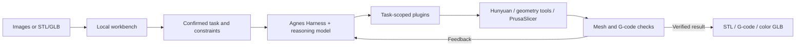

# Xingzao · From Images to Verified 3D-Printing Plans

English | [简体中文](README.zh-CN.md)

**An Agnes Harness workbench for image-based modeling, color preview, and slicer-in-the-loop checks.**

[Demo video](#demo-video) · [Quick start](#quick-start) · [Architecture](#architecture) · [Integration standards](#integration-standards) · [Full setup](docs/getting-started.md)


8-second visual summary · [Download the full narrated demo (4:21, 17.9 MiB)](https://github.com/wangsanhong165-byte/xingzao-agh/raw/refs/heads/main/demo/xingzao-demo.mp4) · [Read the results online](docs/results.md)

## Project Overview

A model that looks complete on screen can still lose a thin rod during slicing or require support near an important surface. Creators then have to move between modeling software, a slicer, and manual checks to find a usable plan.

Xingzao brings these steps into one local workbench. Start with front/side/back images or an existing STL/GLB, confirm the important region or rod and the allowed changes, then let **Agnes Harness (AGH)** coordinate generation, tool execution, feedback, and verification.

### Core features

| Capability | What the workbench does |
| --- | --- |
| Image-based modeling | Runs local Hunyuan3D-2mv, checks the generated mesh, and performs an initial slice. |
| Color preview | Uses Hunyuan3D-Paint 2.0 Turbo with an illustration reference; keeps the manufacturing geometry separate from the textured GLB. |
| Appearance protection | Compares five declared print poses, measures support extrusion near a user-confirmed region, and shows whole-part material/time estimates. |
| Thin-rod preservation | Checks feature coverage and the full confirmed rod centerline against model extrusion paths. Tries original geometry in different poses and supports bounded local thickening where allowed. |
| Verified delivery | Rechecks the selected model, profile, transforms, and G-code before releasing the final files. Unsatisfied constraints stop delivery. |

### What is distinctive

- **Slicing is part of the decision loop.** Checks read actual PrusaSlicer G-code, rather than treating a closed mesh as sufficient evidence.
- **Measurements share one source coordinate system.** Support paths are mapped back to the same protected region so pose comparisons remain meaningful.
- **Repair has a budget.** Rod changes are constrained by the allowed region, radial growth, and added volume; a feasible original pose can avoid geometry changes.
- **Decisions remain inspectable.** The workbench connects tool feedback, task state, file hashes, and AGH execution records.

### Recorded examples

| Example | Before → after | Meaning |
| --- | --- | --- |
| Photographic skull model, same protected region/profile | Support path length **34.898 m → 7.911 m (−77.33%)**; slicer material estimate **39.01 g → 33.81 g** | Reduced planned support near the protected surface; the percentage is a local path metric. |
| Controlled lamp-post rod, upright | Original **0.5 mm** fails; **0.7 mm** still has a centerline gap; **0.8 mm** passes | Feature samples alone are insufficient; the complete centerline is checked too. |
| Separate five-pose lamp-post task | Original **0.5 mm** rod passes in the side-oriented pose, **0.80 g / 346 s** estimated | Changing pose can preserve the original geometry. |

The repair experiments and five-pose task are separate records. Current evidence covers software geometry and planned extrusion paths; physical printing, fit, and strength remain future experiments. See the [results and evidence](docs/results.md) and [architecture guide](docs/architecture.md).

## Demo Video

[](https://github.com/wangsanhong165-byte/xingzao-agh/raw/refs/heads/main/demo/xingzao-demo.mp4)

**[Download the complete MP4 — 4 minutes 21 seconds](https://github.com/wangsanhong165-byte/xingzao-agh/raw/refs/heads/main/demo/xingzao-demo.mp4)** · [Results you can read on GitHub](docs/results.md) · [AGH-exported execution records](evidence/agh)

The full video has Chinese narration and includes modeling/color review, AGH decisions, support comparison, thin-rod checks, and stopping/recovery. The preview above uses selected frames with English captions. Download the MP4 to play it locally; GitHub's file preview cannot play this large video. A fresh clone does not contain the developer's private images or task database.

## Quick Start

### 1. Recheck the included results — no model account or GPU

Install **Node.js 24.10+** with npm. In Windows PowerShell:

```powershell
git clone https://github.com/wangsanhong165-byte/xingzao-agh.git
cd xingzao-agh
npm.cmd ci
node tools/review/run.mjs
```

Open the generated `复核报告.html` in a browser. The command verifies bundled files and recalculates G-code checks. Some mesh probes are cached; the report identifies the verification scope.

### 2. Regenerate a standard part and run the real slicer

With **Windows x64 and Python 3.12**:

```powershell
py -3.12 tools/setup/reproduce.py environment --kind cpu-review
py -3.12 tools/setup/reproduce.py assets --scope slicer
& .\data\reconstruction\env-torch-readonly\Scripts\python.exe tools/setup/reslice.py
```

This creates new STL/G-code files and a result page under `data/reproduction-runs/`. Setup downloads pinned dependencies and PrusaSlicer; no image-generation model is called.

### 3. Open the workbench and prepare new tasks

```powershell
$env:PHOTO_CAD_AGH_HOME = Join-Path $env:USERPROFILE '.agh-print-detail-v2'
npm.cmd start
```

Open **http://127.0.0.1:4337/**. The current UI is in Chinese. Before executing new AGH tasks, follow the [full setup guide](docs/getting-started.md) to install the CPU tools, build the pinned AGH runtime, and configure your own model account. Image modeling and texturing additionally require GPU dependencies and model weights.

## Architecture



AGH coordinates the process; geometry and slicer services compute the metrics and enforce the constraints. Pose selection uses the service-ranked feasible candidates, rather than a model-invented score. [Modules, algorithms, and source map →](docs/architecture.md)

## Integration Standards

- **AGH plugins:** four business packages register structured tools through `ctx.extension().registerTool()` and communicate with the local workbench over HTTP/JSON.
- **Task binding:** per-task IDs/tokens, candidate IDs, and ordered execution gates connect calls to the correct job.
- **Artifacts:** STL for manufacturing geometry, GLB/glTF for color review, PrusaSlicer G-code for extrusion analysis, and SHA-256 for file identity.
- **Reproducibility:** pinned AGH revision, model revisions, slicer version, configuration, and source-coordinate transforms accompany the workflow.

[Tool names, HTTP routes, data conventions, and extension steps →](docs/integration.md)

## Environment and Scope

The recorded local platform is **Windows 11, RTX 5060 Laptop 8 GB VRAM, and 16 GB RAM**. Reviewing included files and running CPU manufacturing checks do not require a GPU. Full shape/texture inference uses separate Python environments; see [setup and troubleshooting](docs/getting-started.md).

Local repair currently targets **one user-confirmed, axis-aligned straight circular rod**. Color output is RGB preview, not a claim of PBR materials or color FDM printing. No physical printer/MHS device integration is included in this release.

## License and Attribution

Original project code is licensed under [Apache-2.0](LICENSE). AGH adaptations and third-party code, models, datasets, and demo media retain their own terms; see [NOTICE](NOTICE) and [third-party sources and licenses](THIRD_PARTY_NOTICES.md). Weights, private task data, and account credentials are not distributed. Use your own authorized inputs and configure keys in your own AGH account; optional environment fields are listed in [.env.example](.env.example).
