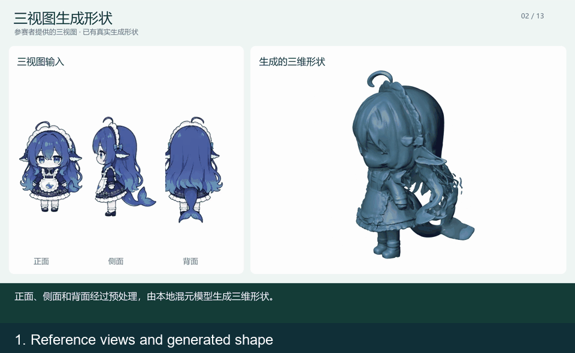
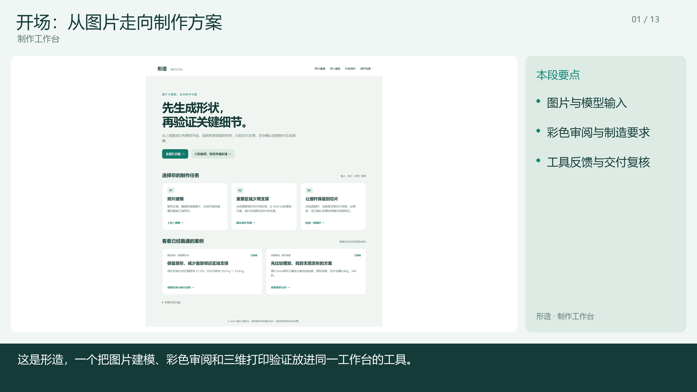
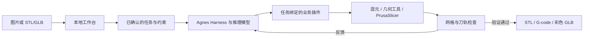

# 形造 · 从图片到经过验证的3D打印方案

[English](README.md) | 简体中文

**基于 Agnes Harness，将图片建模、彩色审阅和切片在环检查放进同一个工作台。**

[演示视频](#演示视频) · [快速开始](#快速开始) · [架构介绍](#架构介绍) · [集成标准](#集成标准) · [完整配置](运行与模型配置.md)



8秒关键画面摘要 · [下载完整配音视频（4分21秒，17.9 MiB）](https://github.com/wangsanhong165-byte/xingzao-agh/raw/refs/heads/main/demo/xingzao-demo.mp4) · [在线查看结果](docs/results.zh-CN.md)

## 项目介绍

屏幕上看起来完整的模型，进入切片后仍可能丢失细杆，或在重要表面附近生成大量支撑。创作者需要在建模软件、切片器和人工检查之间反复切换，才能找到可用的方案。

形造把这些步骤组织在同一个本地工作台中。用户从正、侧、背图片或已有 STL/GLB 开始，确认需要保留的区域或细杆，以及允许修改的范围，再由 **Agnes Harness（AGH）**组织生成、工具执行、反馈调整和结果验证。

### 核心功能

| 能力 | 工作台执行的任务 |
| --- | --- |
| 图片建模 | 调用本地 Hunyuan3D-2mv，检查生成网格并完成初次切片。 |
| 彩色审阅 | 以插画为参考调用 Hunyuan3D-Paint 2.0 Turbo；制造几何与带纹理的 GLB 分别保存。 |
| 外观保护 | 比较5个声明的打印姿态，统计用户确认区域附近的支撑挤出路径，同时展示整件耗材与时间估算。 |
| 细杆保留 | 将特征点和用户确认的完整杆轴线与模型挤出路径比较；先尝试原件姿态，必要且允许时做受限局部加粗。 |
| 验证后交付 | 交付前重新核对模型、配置、坐标变换和 G-code；没有满足约束的方案时停止交付。 |

### 创新亮点

- **把切片反馈用于决策。** 读取 PrusaSlicer 实际生成的 G-code，不以网格闭合作为唯一通过条件。
- **在同一源坐标下比较。** 将支撑路径映射回同一个保护区域，避免不同姿态的统计范围失去可比性。
- **让修正受预算约束。** 限定细杆的允许区域、径向增长及新增体积；原件存在可行姿态时可以保留原形。
- **让结果可以追查。** 工具反馈、任务状态、文件哈希与 AGH 执行记录共同说明方案如何得到。

### 已有案例

| 案例 | 修改前 → 修改后 | 说明 |
| --- | --- | --- |
| 摄影头骨模型，同一保护区域与配置 | 区域支撑路径 **34.898 m → 7.911 m（减少77.33%）**；整件耗材估算 **39.01 g → 33.81 g** | 降幅表示保护区附近的计划支撑路径变化。 |
| 标准灯柱细杆，直立姿态 | 原件 **0.5 mm** 未通过；**0.7 mm** 仍有轴线缺口；**0.8 mm** 通过 | 特征采样通过后，仍需检查完整轴线的刀轨连续性。 |
| 独立的灯柱五姿态任务 | 原件 **0.5 mm** 细杆侧放通过，估算 **0.80 g / 346 s** | 调整摆放可以避免修改原几何。 |

局部修正试验与五姿态任务是独立记录。当前证据覆盖软件几何和计划挤出路径，实物打印、装配及强度留待后续实验。详见[结果与证据](docs/results.zh-CN.md)和[技术架构](docs/architecture.zh-CN.md)。

## 演示视频

[](https://github.com/wangsanhong165-byte/xingzao-agh/raw/refs/heads/main/demo/xingzao-demo.mp4)

**[下载完整MP4：4分21秒](https://github.com/wangsanhong165-byte/xingzao-agh/raw/refs/heads/main/demo/xingzao-demo.mp4)** · [在线查看案例结果](docs/results.zh-CN.md) · [AGH官方界面导出的执行记录](evidence/agh)

完整视频采用中文配音，展示建模与彩色审阅、AGH决策、支撑比较、细杆检查以及停止与恢复。上方预览选取视频关键帧并添加英文说明。完整MP4请下载后播放，GitHub文件页无法直接预览该大小的视频。首次克隆不包含开发机的私人图片或历史任务数据库。

## 快速开始

### 1. 复核已有结果：无需模型账号或GPU

安装包含 npm 的 **Node.js 24.10+**。在 Windows PowerShell 中执行：

```powershell
git clone https://github.com/wangsanhong165-byte/xingzao-agh.git
cd xingzao-agh
npm.cmd ci
node tools/review/run.mjs
```

用浏览器打开生成的 `复核报告.html`。命令重新检查随仓库文件并计算 G-code 指标；部分网格探针使用缓存，具体范围在报告中标明。

### 2. 重新生成标准件并调用真实切片器

准备 **Windows x64、Python 3.12**，执行：

```powershell
py -3.12 tools/setup/reproduce.py environment --kind cpu-review
py -3.12 tools/setup/reproduce.py assets --scope slicer
& .\data\reconstruction\env-torch-readonly\Scripts\python.exe tools/setup/reslice.py
```

新 STL、G-code 和结果页保存在 `data/reproduction-runs/`。安装器下载固定版本依赖和 PrusaSlicer；此流程不调用图片生成模型。

### 3. 打开工作台并准备新任务

```powershell
$env:PHOTO_CAD_AGH_HOME = Join-Path $env:USERPROFILE '.agh-print-detail-v2'
npm.cmd start
```

浏览器打开 **http://127.0.0.1:4337/**。当前界面为中文。执行新的 AGH 任务前，按[完整配置说明](运行与模型配置.md)准备 CPU 工具、固定版本 AGH 和本人的模型账号。图片建模与上色另需 GPU 依赖和模型权重。

## 架构介绍



AGH组织流程，几何与切片服务负责计算指标、执行约束。姿态选择使用服务给出的可行候选排序，评分由程序计算。[模块、算法与代码入口 →](docs/architecture.zh-CN.md)

## 集成标准

- **AGH插件：** 4个业务包通过 `ctx.extension().registerTool()` 注册结构化工具，以 HTTP/JSON 调用本地工作台。
- **任务绑定：** 每个任务的 ID、访问令牌、候选 ID 及执行顺序约束，将调用绑定到对应任务。
- **文件格式：** STL 保存制造几何，GLB/glTF 用于彩色审阅，PrusaSlicer G-code 用于挤出分析，SHA-256 用于文件身份核对。
- **复现信息：** 固定 AGH 提交、模型版本、切片器版本与配置，并保留源坐标变换。

[工具名称、HTTP接口、数据约定与扩展方法 →](docs/integration.zh-CN.md)

## 环境与适用范围

已有本地运行平台为 **Windows 11、RTX 5060 Laptop 8 GB显存、16 GB内存**。文件复核和 CPU 制造检查不需要 GPU；完整形状生成与上色使用独立 Python 环境，详见[环境配置与排错](运行与模型配置.md)。

局部修正当前限于**用户确认的单根轴对齐直圆杆**。彩色输出为 RGB 审阅资产，不表示 PBR 材质或彩色 FDM 打印。本版本未接入实体打印机或 MHS 设备。

## 开源许可与来源

项目原创代码采用 [Apache-2.0](LICENSE)。AGH适配、第三方代码、模型、数据集与演示素材保留各自条款，见 [NOTICE](NOTICE) 和[第三方来源与授权说明](THIRD_PARTY_NOTICES.md)。仓库不分发模型权重、私人任务数据或账号凭据。请使用有权使用的输入，并在本人的 AGH 账号中配置 Key；可选环境项见 [.env.example](.env.example)。
