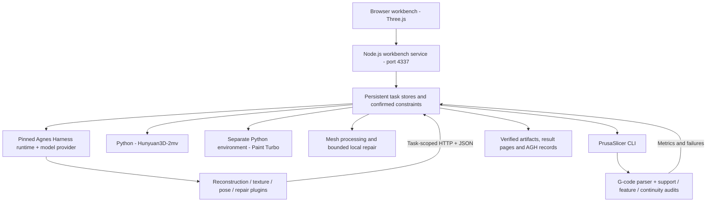

# Architecture

English | [简体中文](architecture.zh-CN.md) · [Project home](../README.md)

## Runtime structure

The reasoning model plans and invokes tools through AGH. The workbench owns task state, computes geometry/toolpath measurements, and enforces delivery requirements. The recorded setup uses DeepSeek V4.1 Flash for planning; shape and texture generation are separate local specialist models.

This release targets the pinned AGH base revision `ec7ebbdb36e7658d2a121c3ba5113e850b16cb63` plus the supplied [adaptations](../agh-adaptation/README.md). The current upstream README is a presentation reference, not a promise of compatibility with its latest APIs.

## Execution and verification

### 1. Reconstruction and color review

The user supplies front, side, and back images and confirms scale/orientation. The reconstruction plugin can generate a candidate, validate its mesh, slice it with the actual slicer, and submit it after these checks.

Color review starts from an existing reconstruction candidate and an illustration reference. Hunyuan3D-Paint 2.0 Turbo produces a textured GLB. The source manufacturing mesh remains separately identifiable; texture verification checks source geometry, UVs, embedded images, and output identity. RGB preview does not imply full PBR or multicolor printing.

### 2. Support near a protected region

The task compares its declared five rigid poses of the same source mesh using a shared slicer profile. The parser distinguishes positive support extrusion from model extrusion, travel, and other moves. After checking bed placement, the evaluator maps paths back into source coordinates and clips them against the protected region expanded for extrusion width/layer height.

The metric is the support path length near that region, not measured contact damage or stress. Feasible candidates are ranked by the service using material and time estimates. The agent must select from the evaluated, permitted candidates; it does not invent new poses or global-optimality claims.

Source: [support evaluation](../src/support-evaluation.mjs), [pose comparison](../src/pose-comparison.mjs).

### 3. Thin-rod coverage and continuity

Two checks answer different questions:

- **Feature coverage:** Are the mesh's feature probes covered by the estimated envelope of model extrusion?
- **Full centerline continuity:** Does the entire user-confirmed rod axis lie within the union of covered intervals? The algorithm intersects the axis with XY extrusion capsules and Z layer slabs, merges intervals, and detects gaps.

Support extrusion is excluded from model coverage. This is why a 0.7 mm rod candidate can pass surface sampling while still failing the centerline check. Line width and layer height describe a planned extrusion envelope; they are not measured printer accuracy.

Source: [feature audit](../src/critical-feature-audit.mjs), [centerline audit](../src/rod-toolpath-continuity.mjs).

### 4. Bounded repair and delivery

The workflow first compares the original geometry in the supported poses. Where repair is needed and permitted, the current implementation thickens one confirmed axis-aligned straight circular rod. It restricts the operation to the allowed region and checks radial growth and added volume, then slices and audits the candidate again.

Delivery rechecks source/candidate/profile/G-code SHA-256 values, rigid transforms, and toolpath conditions. Hashes establish file identity; recalculated measurements establish the declared software checks. A failed constraint produces a stopped result instead of a verified download.

Source: [repair service](../src/local-repair-service.mjs), [repair jobs](../src/repair-jobs.mjs), [pose jobs](../src/pose-jobs.mjs).

## Source map

| Path | Responsibility |
| --- | --- |
| `public/`, `src/print-server.mjs` | Browser workbench and local HTTP service |
| `src/*-jobs.mjs`, `src/*-agh.mjs` | Task persistence, stages, AGH execution, and recovery |
| `reconstruction-agh-plugin/`, `texture-agh-plugin/` | Structured generation and color-review tools |
| `pose-agh-plugin/`, `repair-agh-plugin/` | Structured pose and local-repair tools |
| `src/slicer.mjs`, `tools/slicer/` | Actual CLI slicing, G-code parsing, fixed profiles |
| `tools/reconstruction/` | Python geometry/model workers |
| `tools/setup/` | Pinned dependencies, assets, AGH build, and fresh slicing |
| `tools/review/`, `case/`, `examples/` | Included samples, file bindings, and repeatable checks |
| `evidence/agh/` | Execution records exported through the AGH interface |

## Evidence levels

| Operation | What it establishes |
| --- | --- |
| `node tools/review/run.mjs` | File identity and recalculated checks on included G-code; some mesh probes are cached |
| `tools/setup/reslice.py` | New standard-part meshes and newly generated PrusaSlicer G-code |
| A configured live workbench task | A new AGH/tool execution with its own inputs, output files, and records |
| Physical printing | Future validation of material behavior, adhesion, appearance, fit, and strength |

These levels should be reported separately. Existing files cannot establish a fresh model request or a physical experiment.

[Integration contracts](integration.md) · [Setup](getting-started.md)
