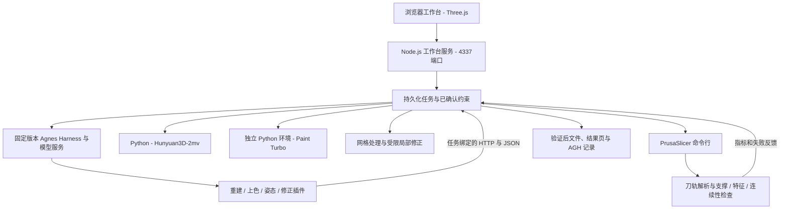

# 技术架构

[English](architecture.md) | 简体中文 · [项目首页](../README.zh-CN.md)

## 运行结构

推理模型通过 AGH 规划并调用工具；工作台负责持有任务状态、计算几何和刀轨指标、执行交付条件。已有运行使用 DeepSeek V4.1 Flash 进行规划；形状与纹理由独立的本地专业模型生成。

本版本使用固定 AGH 基础提交 `ec7ebbdb36e7658d2a121c3ba5113e850b16cb63` 和仓库内的[适配](../agh-adaptation/README.md)。上游当前 README 用作展示格式参考，不代表本项目已适配上游最新接口。

## 执行与验证

### 1. 重建与彩色审阅

用户提供正、侧、背图并确认尺度和朝向。重建插件可以生成候选、验证网格、调用实际切片器，再提交通过检查的结果。

彩色审阅从已有重建候选和插画参考开始，由 Hunyuan3D-Paint 2.0 Turbo 输出带纹理 GLB。制造源网格保留独立身份；纹理验证检查源几何、UV、内嵌图片和输出文件身份。RGB 审阅结果不表示完整 PBR 或多色打印。

### 2. 保护区域附近的支撑

在同一源模型、同一切片配置下，比较任务声明的5个刚体姿态。解析器区分正向支撑挤出、模型挤出、空移和其他动作。验证热床放置偏移后，将路径映射回源坐标，并根据线宽和层高扩展保护区域，裁取相关支撑路径。

指标是保护区域附近的支撑路径长度，不是实测接触损伤或应力。服务按耗材和时间估算对可行候选排序；智能体只能选择已评估且满足条件的方案，不自行增加姿态或声称全局最优。

源码：[支撑统计](../src/support-evaluation.mjs)、[姿态比较](../src/pose-comparison.mjs)。

### 3. 细杆覆盖与连续性

两类检查回答不同问题：

- **特征覆盖：** 网格特征探针是否落在模型挤出的估计包络内？
- **完整轴线连续性：** 用户确认的整段杆轴线是否被覆盖区间的并集完整包含？算法求轴线与 XY 挤出胶囊、Z 层高区间的交集，再合并区间、检测缺口。

支撑挤出不计入模型覆盖。因此，0.7 mm候选可能通过表面采样，却仍未通过轴线检查。线宽和层高用于估计计划挤出包络，不代表实测打印精度。

源码：[特征检查](../src/critical-feature-audit.mjs)、[轴线连续性](../src/rod-toolpath-continuity.mjs)。

### 4. 受限修正与交付

流程先比较原几何的可用姿态。确需且允许修正时，当前实现针对用户确认的单根轴对齐直圆杆做局部加粗，限制修改区域，检查径向增长和新增体积，再次切片和检查。

交付前核对源模型、候选、切片配置和 G-code 的 SHA-256，重新检查刚体变换和刀轨条件。哈希说明文件身份，重新计算的指标说明软件检查是否满足。硬约束失败时，任务停止，不开放已验证交付。

源码：[修正服务](../src/local-repair-service.mjs)、[修正任务](../src/repair-jobs.mjs)、[姿态任务](../src/pose-jobs.mjs)。

## 代码结构

| 路径 | 职责 |
| --- | --- |
| `public/`、`src/print-server.mjs` | 浏览器工作台和本地 HTTP 服务 |
| `src/*-jobs.mjs`、`src/*-agh.mjs` | 任务持久化、阶段、AGH执行与恢复 |
| `reconstruction-agh-plugin/`、`texture-agh-plugin/` | 结构化重建与上色工具 |
| `pose-agh-plugin/`、`repair-agh-plugin/` | 结构化姿态与局部修正工具 |
| `src/slicer.mjs`、`tools/slicer/` | 实际 CLI 切片、刀轨解析和固定配置 |
| `tools/reconstruction/` | Python 几何与模型工作进程 |
| `tools/setup/` | 固定依赖、资产、AGH构建和重新切片 |
| `tools/review/`、`case/`、`examples/` | 随仓库样例、文件绑定和可重复检查 |
| `evidence/agh/` | 通过 AGH 界面导出的执行记录 |

## 验证层次

| 操作 | 能说明的结果 |
| --- | --- |
| `node tools/review/run.mjs` | 随仓库文件身份和已有 G-code 的重新计算；部分网格探针使用缓存 |
| `tools/setup/reslice.py` | 新生成的标准件网格及重新调用 PrusaSlicer 得到的刀轨 |
| 配置完整后的在线工作台任务 | 使用新输入执行的 AGH与工具调用、输出文件和运行记录 |
| 实物打印 | 后续检验材料、附着、外观、装配与强度 |

不同层次分别报告，已有文件不能证明新的模型请求或实物实验。

[接口与集成约定](integration.zh-CN.md) · [完整配置](../运行与模型配置.md)
