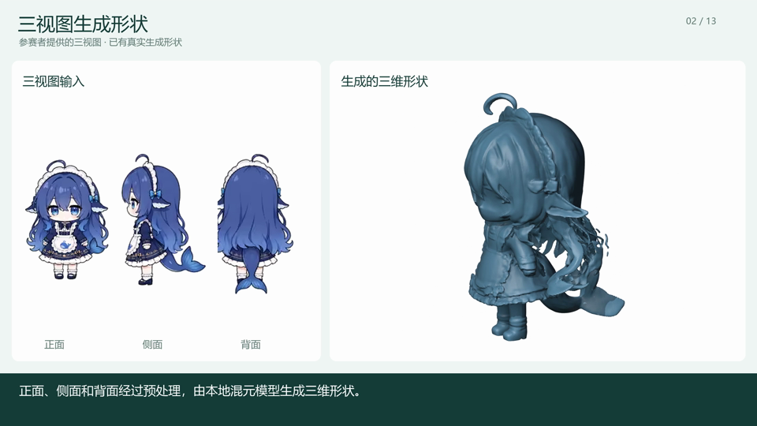
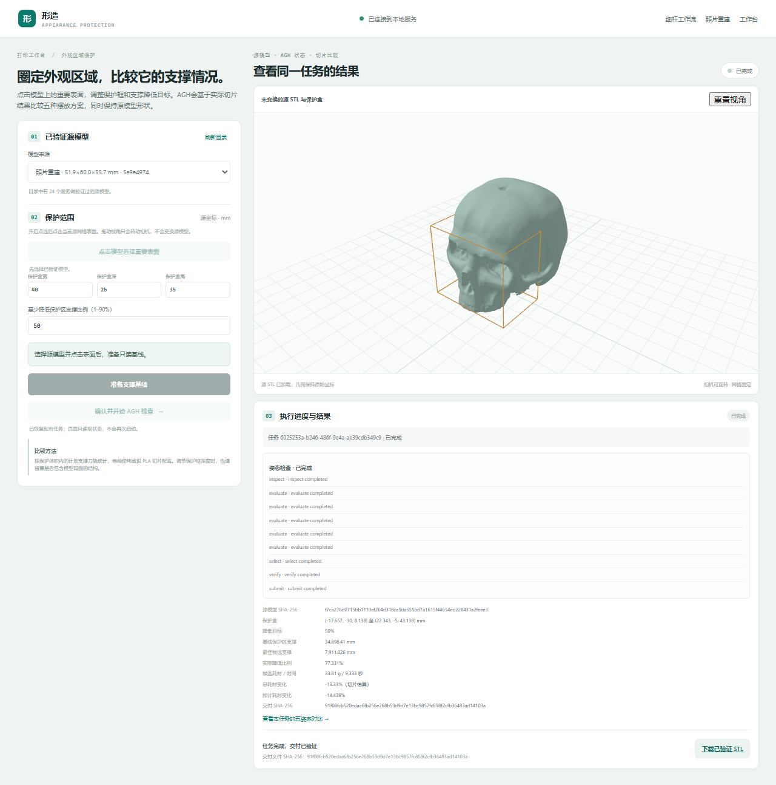
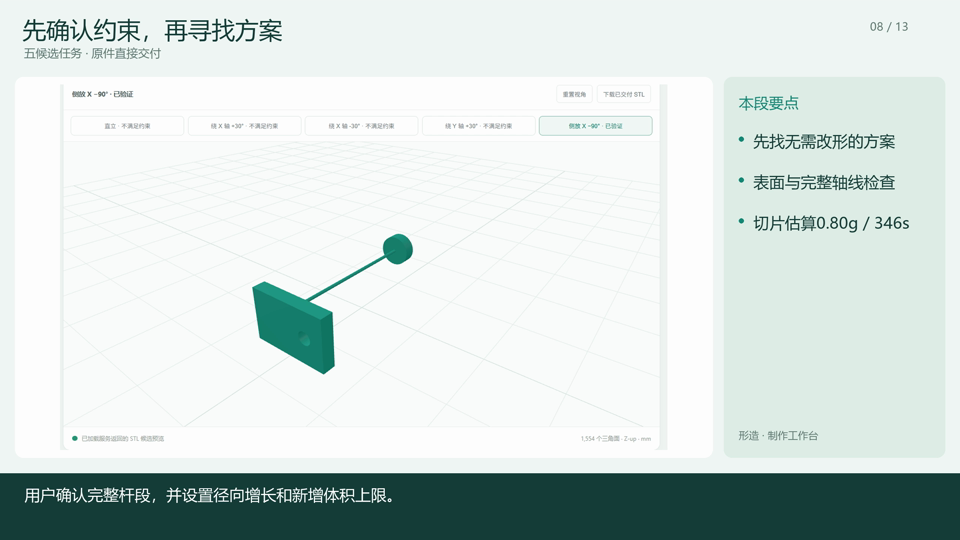

# 结果与证据

[English](results.md) | 简体中文 · [项目首页](../README.zh-CN.md)

本页可直接在 GitHub 阅读。需要在本地重新计算时，在仓库根目录执行 `node tools/review/run.mjs`，再用浏览器打开生成的 `复核报告.html`。

## 1. 从三视图到可审阅模型

已有流程调用本地 Hunyuan3D-2mv，随后检查网格并实际切片。彩色审阅是独立的可选阶段；完整视频包含3个角色上色实例。公开可复现输入使用有许可的[头骨摄影三视图及输入清单](../case/skull-input-manifest.json)。

## 2. 减少重要表面附近的支撑

摄影头骨案例使用同一源模型、尺寸、保护区和切片配置。源坐标保护盒为 **40 × 25 × 35 mm**，任务目标为区域支撑路径至少减少 **50%**，`face-up` 姿态满足要求。

| 指标 | 原件直立 | 选定的正面朝上姿态 |
| --- | --- | --- |
| 保护区域附近的支撑挤出路径 | 34,898.410 mm | 7,911.026 mm |
| 区域路径降幅 | 基线 | **77.33%** |
| 整件耗材估算 | 39.01 g | 33.81 g |
| 打印时间估算 | 10,908 s | 9,333 s |

区域指标估计计划支撑挤出与保护区的重叠情况，不表示整件耗材节省比例或实测外观损伤率。

证据：[案例与变换数据](../examples/photo-protection/case.json)、[基线刀轨](../examples/photo-protection/upright.gcode)、[选定刀轨](../examples/photo-protection/face-up.gcode)、[复核脚本](../examples/photo-protection/复核支撑.mjs)、[实际工具调用摘要](../examples/photo-protection/native-summary.json)。

展开已有工作台结果截图

## 3. 细杆：特征采样与整段连续性

受控灯柱尺寸为 **12 × 8 × 30 mm**，确认的完整轴线长 **26 mm**，采用固定的 **0.4 mm喷嘴、0.2 mm层高**配置：

| 候选 | 轴线覆盖 | 最大缺口 | 刀轨判定 |
| --- | --- | --- | --- |
| 原件0.5 mm，直立 | 4.6% | 24.8 mm | 拒绝 |
| 局部修正到0.7 mm，直立 | 88.5% | 0.4 mm | 特征采样通过，但整段检查仍拒绝 |
| 局部修正到0.8 mm，直立 | 100% | 0 mm | 通过 |
| 原件0.5 mm，侧放 | 100% | 0 mm | 无需改形即可通过 |

局部修正过程和后续原件五姿态交付是**独立实验**。后者保留原形，交付侧放方案，切片估算为 **0.80 g / 346 s**。更紧的径向增长预算不产生允许的加粗候选，但不妨碍独立可行的原件姿态。

证据：[案例定义](../case/cases.json)、[原始STL](../case/source-original.stl)、[原件直立刀轨](../case/baseline.gcode)、[0.7 mm刀轨](../case/boundary.gcode)、[0.8 mm刀轨](../case/normal.gcode)、[原件侧放刀轨](../case/face-up.gcode)、[五姿态源文件与证据](../case/five)。

## 4. 查看智能体的执行过程

[AGH官方界面导出记录](../evidence/agh)包含正常任务、失败任务和小预算任务，可核对模型、工具调用及结果。[修正任务摘要](../case/native-summary.json)和[摄影姿态任务摘要](../examples/photo-protection/native-summary.json)提供更简短的入口。

## 按需要复现

| 目标 | 入口 |
| --- | --- |
| 重算已有刀轨检查 | `node tools/review/run.mjs`，无需账号或GPU |
| 重新生成标准件并切片 | [配置说明第2步](../运行与模型配置.md#第2步重新生成标准件并切片) |
| 执行新的AGH任务 | [配置说明第3～4步](../运行与模型配置.md#第3步准备专业工具agh与模型账号) |
| 图片建模与彩色审阅 | [配置说明第5～6步](../运行与模型配置.md#第5步可选图片建模与彩色审阅) |

文件复核使用已有网格探针，不重新进行图片推理。这些案例尚未完成实物打印、装配、附着和强度实验。模型权重、私人输入图片与开发机任务数据库不随仓库分发。
